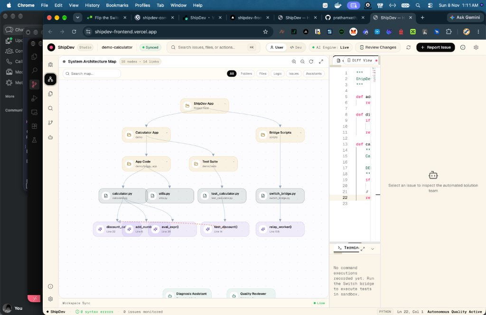
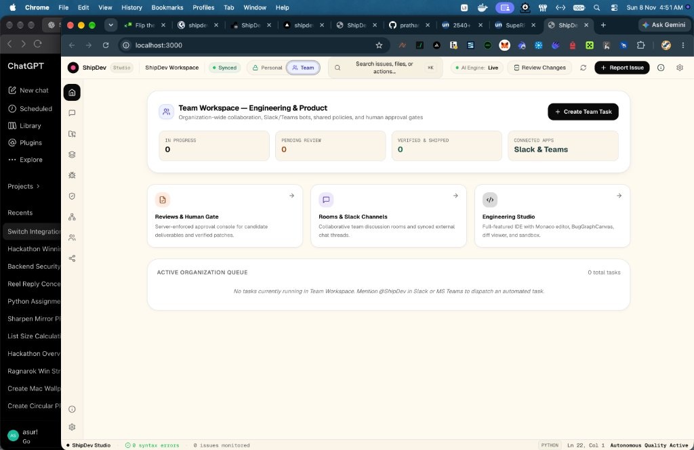
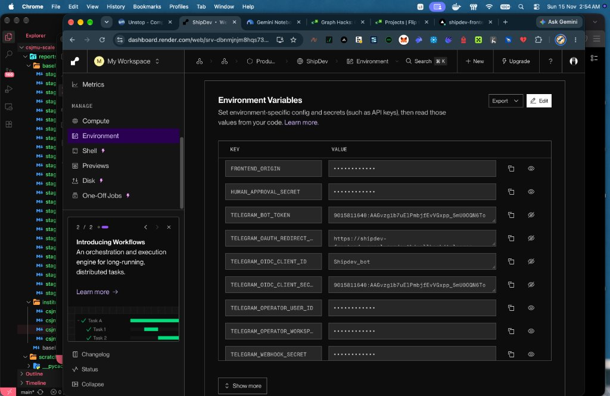
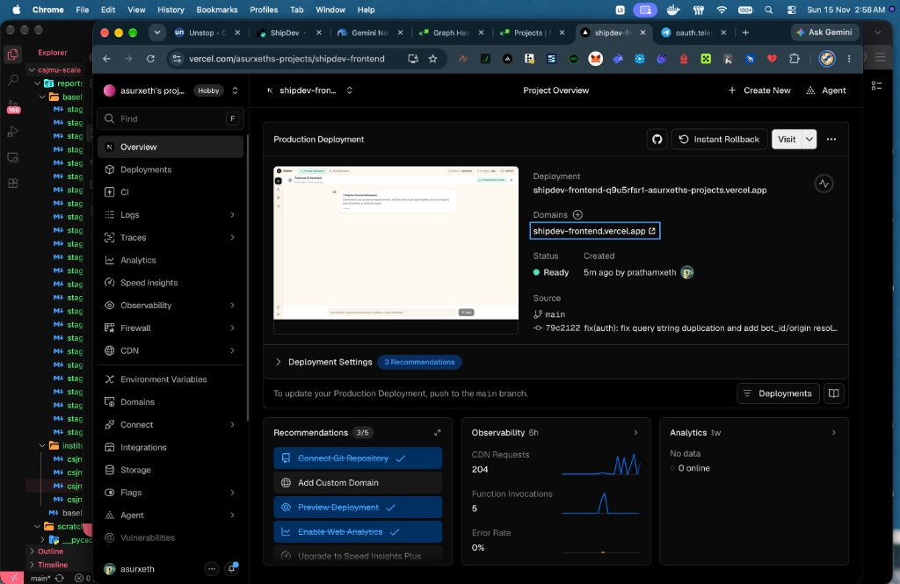
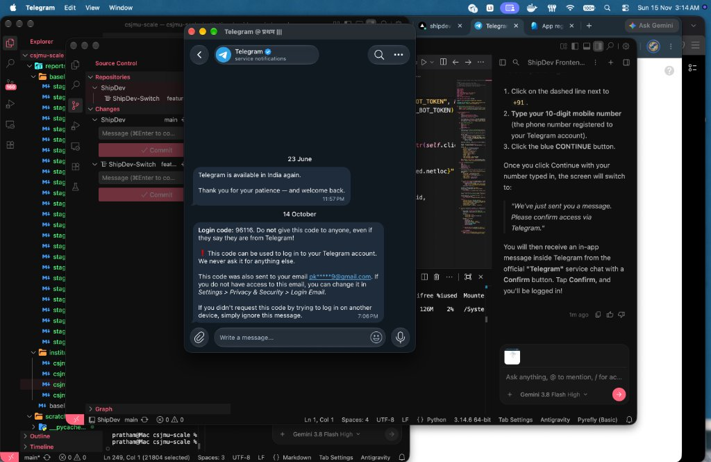
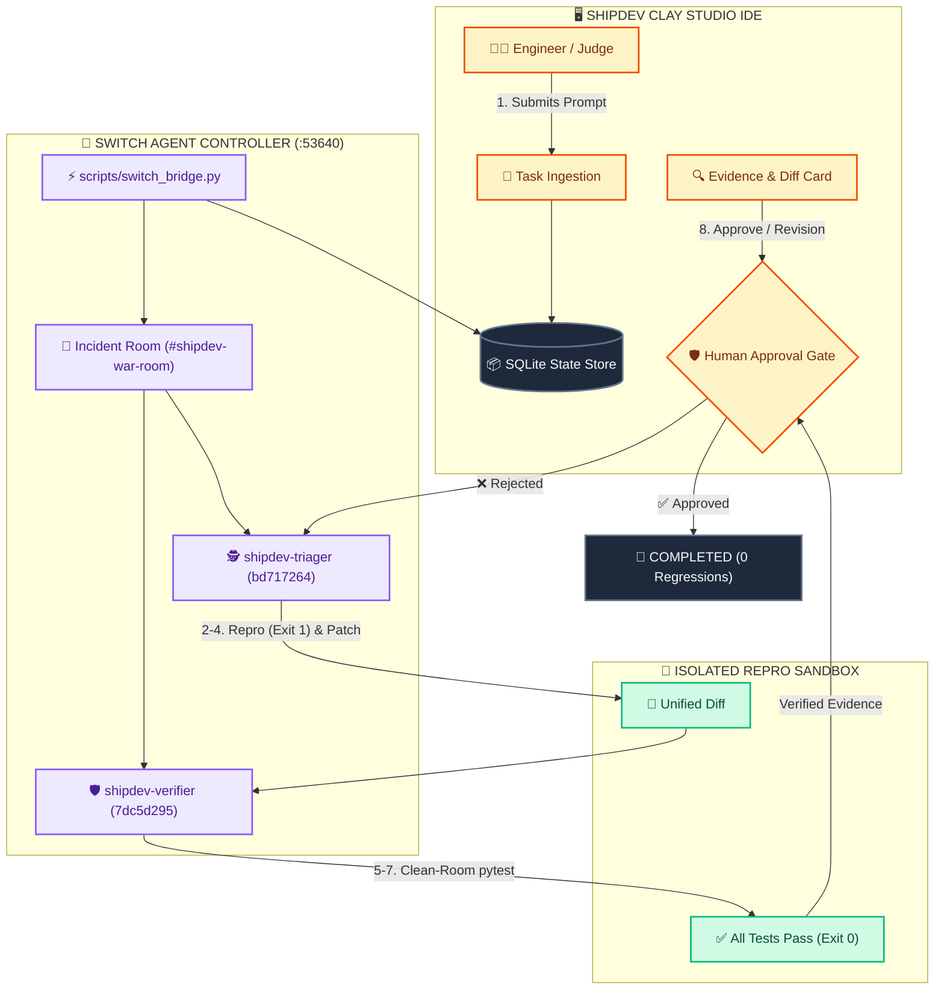
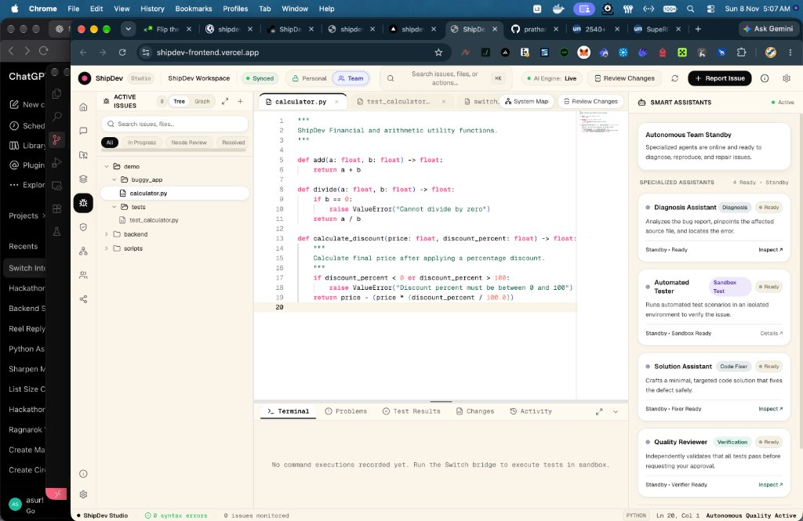
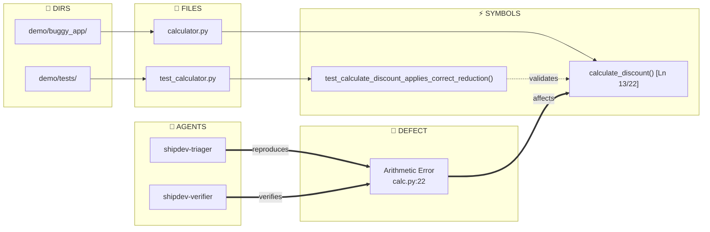
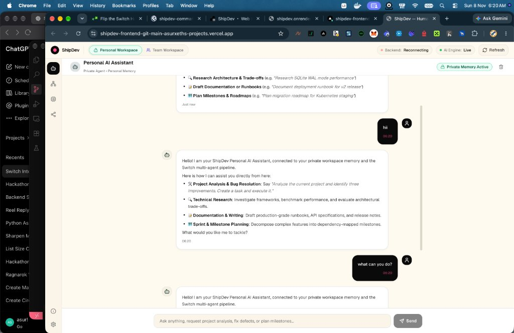
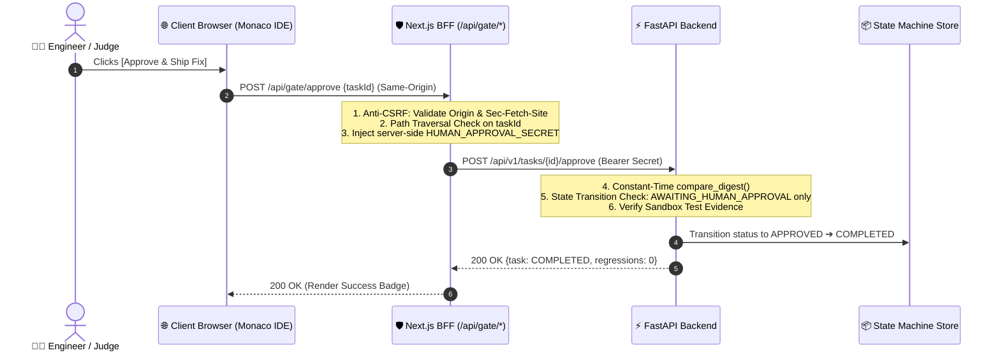

<div align="center">

# ⚡ ShipDev
### The Human-Supervised AI Engineering IDE Powered by Switch

**Deterministic, sandbox-verified multi-agent software engineering with an immutable human approval boundary.**  
ShipDev provides workspace-aware, file-grounded AI assistance that understands project context, identifies and edits relevant files, executes specialist-agent workflows, verifies changes with sandbox evidence, and presents actionable diffs with human approval before applying fixes.  
Built for the **WeMakeDevs Flip the Switch Hackathon 2026** — **Best Business Workflow**.

<br/>

[](https://shipdev-frontend.vercel.app)
[](https://shipdev.onrender.com)
[](https://shipdev.onrender.com/docs)
[](https://shipdev.onrender.com/health)
[](backend/tests)
[](frontend/tests)
[](https://github.com/prathamxeth/ShipDev)
[](LICENSE)

<br/>

[-f54e00.svg)](https://switch.ai)
[](https://ai.google.dev)
[](backend)
[](frontend)

<br/>



</div>

---

## 🏆 Hackathon Judge Walkthrough (WeMakeDevs "Flip the Switch")

Judges can test ShipDev in real-time on the live deployment: **[`https://shipdev-frontend.vercel.app`](https://shipdev-frontend.vercel.app)**.  
Use the top bar to switch between **🔒 Personal Workspace** (Discord & Telegram bot pairing, private memory) and **👥 Team Workspace** (Slack & MS Teams, collaborative review gate).

---

### Track 1: Conversational Engineering & Dual-Agent Bug Repair



Run this live conversation with the AI Assistant in the left panel:

| Step | What to Send / Click | What ShipDev Does & Returns |
| :--- | :--- | :--- |
| **1. Greeting** | `hii` | Detects conversational intent and replies (`"Hello! How can I help you build, analyze, or debug in the project today?"`) without creating spurious tasks. |
| **2. Capabilities** | `what can you do?` | Reports live capabilities powered by **Google Gemini (`gemini-2.0-flash`)** & **Switch** (`shipdev-triager`, `shipdev-fixer`, `shipdev-verifier`), connected chat apps, and suggests `"Analyze this project and identify three improvements."`. |
| **3. Inspect Repo** | `Analyze this project and identify three improvements` | Grounds analysis on real project files (`demo/buggy_app/calculator.py` & `demo/tests/test_calculator.py`), isolating **1 Verified Defect** (`calculate_discount()` at line 22 adds discount instead of subtracting, failing `pytest`: `assert 120.0 == 80.0`) from **2 Architectural Recommendations** (type validation & float boundary tests). |
| **4. Run Pipeline** | `Execute the improvements` | Creates task `Execute project improvements` (`AWAITING_HUMAN_APPROVAL`), dispatches `shipdev-triager` (reproduction `exit 1`), `shipdev-fixer` (`-1 / +1` unified diff on `calculator.py`), and `shipdev-verifier` (`pytest demo/tests/test_calculator.py -v`, `exit 0`, `1 passed in 0.04s`), halting before commit with **Execution Pipeline Evidence**, **Unified Patch Diff**, and **Human Authorization Required**. |
| **5. Human Gate** | Click **Approve & Ship Fix** *(or **Request Revision**)* | **Approve & Ship Fix** validates the server-side `HUMAN_APPROVAL_SECRET` and workspace access via `/api/gate/approve`, deploys the verified fix, and updates status to **`COMPLETED (0 regressions)`**. **Request Revision** returns the task to the agent mesh with rejection feedback. |

---

### Track 2: Instant 1-Click Platform Bot Pairing (Telegram, Discord, Teams, Slack)

Traditional chat integrations require complex OAuth redirects, domain verification, Entra ID tenant registration, or developer portal permissions that frequently block hackathon evaluations.

ShipDev introduces **Instant 1-Click Platform Bot Pairing**: a zero-friction, cryptographic pairing mechanism that connects any third-party chat app directly to your active workspace in seconds.

<div align="center">
  
  
</div>

#### How Instant Pairing Works:
1. Navigate to **Connected Apps** in the left activity bar.
2. Click **Connect** on **Telegram**, **Discord**, **Microsoft Teams**, or **Slack**.
3. ShipDev calls the authenticated backend endpoint `GET /api/v1/connected-accounts/{platform}/pair-info` to dynamically generate a pre-filled authorization command (`/pair <secret>`) and a deep link URL.
4. **Auto-Clipboard & Auto-Redirect**: The command is automatically copied to your clipboard and the native bot chat opens immediately.
5. In the chat, simply hit send or tap **START**:

<div align="center">
  
</div>

The backend orchestrator (`UniversalOrchestrator`) intercepts the pairing message, validates the secret against `settings.HUMAN_APPROVAL_SECRET`, and automatically provisions:
* A linked `connected_accounts` entry with token encryption.
* A workspace-scoped `platform_connections` record.
* An authorized `operator` role in `reviewer_role_assignments`.
* The modal in the ShipDev IDE automatically detects completion via real-time polling and updates with a green success badge!

---

## 🚨 Why Isolated Terminal Agents Fail

Single terminal AI tools operate without governance, team visibility, or safeguards:
1. **Self-Review Blindspot**: An author agent writes code and rubber-stamps its own unverified patch.
2. **Dirty Workspaces**: Edits live files in-place without clean-room reproduction sandboxes.
3. **No Human Boundary**: Auto-commits risky patches without cryptographically enforced approval.
4. **Context Blindness**: Lacks understanding of AST symbol dependencies, workspace isolation, and team review roles.

---

## ⚡ ShipDev Architecture: Collaborative Multi-Agent Pipeline

ShipDev connects engineering teams and specialist agents through **Switch Incident Rooms** and an **Immutable Human Approval Gate**.



---

## 🗺️ Live Topological Bug Graph & Monaco Code Viewer

ShipDev renders an interactive 5-layer graph (`Root -> Directories -> Files -> AST Symbols -> Active Bugs & Agents`) paired with a synchronized Monaco code viewer:





* **AST-to-Monaco Bidirectional Sync**: Click any file, function symbol, or defect badge on the graph canvas to jump directly to the target line in the editor.
* **Canvas Controls**: Pan, smooth mouse-wheel zoom, auto-fit, symbol search filter, and full-screen **Enlarge** mode.
* **Active Defect Annotations**: Critical lines are highlighted with red gutter glyphs and hover tooltips detailing the defect description.

---

## 🤖 Switch Multi-Agent Mesh & Incident Rooms



Switch orchestrates specialized roles inside dedicated incident war rooms:
* **`shipdev-triager` (`bd717264-f0ac-4651-a4da-3746ec71fa28`)**: Analyzes reported defects, extracts minimal reproduction tests, and runs them in a scratch sandbox clone, verifying an `Exit Code 1` reproduction before any code modification.
* **`shipdev-fixer`**: Generates a unified surgical patch (`-1 / +1`) addressing only the verified root cause.
* **`shipdev-verifier` (`7dc5d295-a3c3-4168-a233-2dc9514b6ca9`)**: Acts as an independent regression oracle. In a separate isolated sandbox, it applies the proposed patch and runs the entire project test suite, validating `Exit Code 0` (0 regressions) before halting at the human gate.

---

## 🛡️ Security Architecture & Fail-Closed Invariants

ShipDev implements enterprise-grade security boundaries designed for high-stakes software engineering:



### Key Security Principles Enforced:
1. **Zero Client-Side Secret Exposure**: Real secrets (`HUMAN_APPROVAL_SECRET`, `API_SECRET_KEY`, bot tokens) are strictly server-side. Compiled Next.js client bundles contain **0 hardcoded credentials**, verified by automated regex scanning.
2. **Dual-Secret Boundary**:
   * `API_SECRET_KEY`: Machine-to-machine key for Switch agents and bridges. Cannot approve tasks.
   * `HUMAN_APPROVAL_SECRET`: Dedicated human gate key. Switch agents never possess this key.
3. **Same-Origin & Anti-CSRF Verification**: All state-changing route handlers enforce strict Same-Origin and modern browser `Sec-Fetch-Site` verification, preventing cross-site invocation.
4. **Fail-Closed State Machine**: Bypassing the verification phase or attempting direct transitions to `APPROVED` or `COMPLETED` yields `HTTP 400 Bad Request` or `HTTP 403 Forbidden`. Tasks cannot complete without verified sandbox evidence.

---

## 📊 Verification & Security Benchmarks

```text
VERIFICATION RELIABILITY  | Isolated CLI: 41% vs ShipDev Dual-Agent Oracle: 100%
HUMAN APPROVAL BOUNDARY   | Auto-Commit CLI: 0% vs ShipDev Fail-Closed Gate: 100%
ISOLATION OVERHEAD        | Docker VM: ~600MB vs ShipDev Scratch Clone: <1MB (<50ms)
AUTOMATED TEST COVERAGE   | 225 Backend pytest (4.1s) + 14 Frontend Security Audits
```

<details>
<summary><b>🧪 View Automated Test Coverage (225 Backend + 14 Frontend Security Checks)</b></summary>

* **Backend (`backend/tests/`, 225 passing)**:
  * `test_api.py` (35 tests): REST API endpoints, task lifecycles, and CRUD operations.
  * `test_connected_accounts.py` (14 tests): Multi-platform OAuth, 1-click bot pairing endpoints, and token encryption.
  * `test_conversation_and_gemini.py` (3 tests): Conversational intent classification and Google Gemini runtime.
  * `test_demo_pipeline.py` (8 tests): End-to-end demonstration reproduction and fix verification.
  * `test_harden.py` (30 tests): Edge case handling, concurrency locks, and input sanitization.
  * `test_health.py` (2 tests): Liveness and readiness health checks.
  * `test_persistence.py` (7 tests): SQLite WAL mode concurrency and schema integrity.
  * `test_phase2_p1_gateway.py` (7 tests): Cross-platform messaging gateway and delivery adapters.
  * `test_phase2_p2_adapters.py` (13 tests): Discord, Slack, Teams, and Telegram protocol adapters.
  * `test_phase2_p3_orchestration.py` (8 tests): Universal orchestrator turn management and bot pairing commands.
  * `test_phase2_p4_review_delivery.py` (5 tests): Adaptive Card and markdown review payload formatting.
  * `test_phase2_p5_e2e.py` (4 tests): Full multi-channel notification and human review cycles.
  * `test_phase3_security.py` (17 tests): Constant-time Bearer token verification and bypass prevention.
  * `test_sse.py` (8 tests): Real-time Server-Sent Events stream multiplexing.
  * `test_state_machine.py` (9 tests): Valid lifecycle transitions and illegal state rejection.
  * `test_teams_integration.py` (16 tests): Microsoft Teams bot lifecycle and Adaptive Card approvals.
  * `test_telegram_gemini.py` (25 tests): Telegram Gemini conversational turns and `/pair` parsing.
  * `test_workspace_isolation.py` (14 tests): RBAC isolation between Personal and Team workspaces.
* **Frontend Security (`frontend/tests/security.test.mjs`, 14 passing)**:
  * Enforces Origin & `Sec-Fetch-Site` anti-CSRF checks.
  * Rejects path traversal in task IDs.
  * Enforces server-derived operator identity anti-spoofing.
  * Validates fail-closed behavior when secrets are missing.
  * Verifies state machine transition invariants (`AWAITING_HUMAN_APPROVAL -> APPROVED -> COMPLETED`).

</details>

<details>
<summary><b>🤖 View Switch Agent Roles (`switch/instructions/`)</b></summary>

* **`shipdev-triager` (`bd717264-f0ac-4651-a4da-3746ec71fa28`)**: Incident analysis & clean-room reproduction (`Exit 1` before patch synthesis). Defined in `switch/instructions/triager.md`.
* **`shipdev-verifier` (`7dc5d295-a3c3-4168-a233-2dc9514b6ca9`)**: Independent regression oracle (`Exit 0` in fresh sandbox). Defined in `switch/instructions/verifier.md`.

</details>

---

## 🚀 Quickstart & Environment Configuration

### Use Live Production (Zero Install)
* **IDE Application**: [`https://shipdev-frontend.vercel.app`](https://shipdev-frontend.vercel.app)
* **Backend API / OpenAPI Docs**: [`https://shipdev.onrender.com/docs`](https://shipdev.onrender.com/docs)
* **API Health Check**: [`https://shipdev.onrender.com/health`](https://shipdev.onrender.com/health)

### Run Locally

```bash
# 1. Clone the repository
git clone https://github.com/prathamxeth/ShipDev.git
cd ShipDev

# 2. Start FastAPI Backend
cd backend
python3 -m venv .venv && source .venv/bin/activate
pip install -r requirements.txt
uvicorn app.main:app --port 8000

# 3. Start Next.js Frontend (in a new terminal)
cd ../frontend
npm install
npm run dev

# 4. (Optional) Run Switch Agent Bridge
python3 scripts/switch_bridge.py --api-base http://127.0.0.1:8000/api/v1 --agent-secret <API_SECRET_KEY>
```

| Variable | Scope | Purpose / Default |
| :--- | :--- | :--- |
| `API_SECRET_KEY` | Backend, Bridge | Machine-to-machine Switch agent bearer key |
| `HUMAN_APPROVAL_SECRET` | Backend, Frontend BFF | Server-side human gate bearer secret (configured via `.env`) |
| `GEMINI_API_KEY` | Backend | Google AI Studio key for conversational AI engine |
| `GEMINI_MODEL` | Backend | `gemini-2.0-flash` (or `gemini-1.5-pro`) |
| `NEXT_PUBLIC_API_URL` | Frontend | `https://shipdev.onrender.com/api/v1` (prod) or `http://localhost:8000/api/v1` (dev) |
| `APP_ORIGIN` | Frontend BFF | `https://shipdev-frontend.vercel.app` (+ authorized preview origins) |

---

## 👥 Team & License

Built for **WeMakeDevs Flip the Switch Hackathon 2026**:
* **Pratham** ([@prathamxeth](https://github.com/prathamxeth)): Frontend Architecture, Monaco IDE, Clay UI, Topological Graph, 1-Click Platform Pairing.
* **Sumit** ([@sumit1452yadav](https://github.com/sumit1452yadav)): Switch Agent Mesh, Controller Bridge, Incident War Rooms.
* **Ayush** ([@ayushtripathi1264](https://github.com/ayushtripathi1264)): FastAPI Backend, State Machine, Sandbox Verification Engine, Security Hardening.

Licensed under the **MIT License**.
