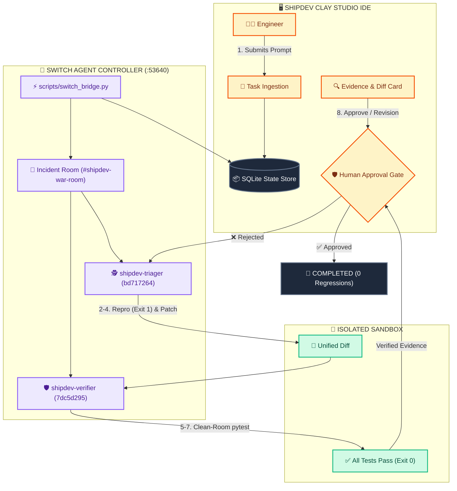
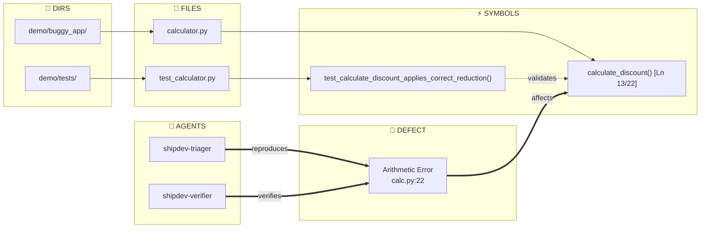
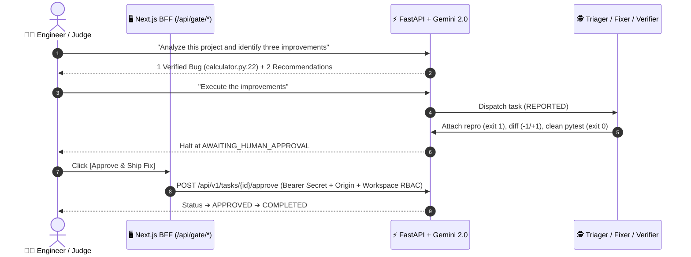

<div align="center">

# ⚡ ShipDev
### The Human-Supervised AI Engineering IDE Powered by Switch

**Deterministic, sandbox-verified multi-agent software engineering with an immutable human approval boundary.**  
ShipDev provides workspace-aware, file-grounded AI assistance that understands project context, identifies and edits relevant files, executes specialist-agent workflows, verifies changes with sandbox evidence, and presents actionable diffs with human approval before applying fixes.  
Built for the **WeMakeDevs Flip the Switch Hackathon 2026** — **Best Business Workflow**.

<br/>

[](https://shipdev-frontend.vercel.app)
[](https://shipdev.onrender.com)
[](https://shipdev.onrender.com/docs)
[](https://shipdev.onrender.com/health)
[](backend/tests)
[](frontend/tests)
[](https://github.com/prathamxeth/ShipDev)
[](LICENSE)

<br/>

[-f54e00.svg)](https://switch.ai)
[](https://ai.google.dev)
[](backend)
[](frontend)

</div>

---

## 🏆 Hackathon Judge Walkthrough (WeMakeDevs "Flip the Switch")

Open **[`https://shipdev-frontend.vercel.app`](https://shipdev-frontend.vercel.app)**, choose **Personal Workspace** or **Team Workspace** in the top bar, and run this live conversation in the AI Assistant:

| Step | What to Send / Click | What ShipDev Does & Returns |
| :--- | :--- | :--- |
| **1. Greeting** | `hii` | Detects conversational intent and replies (`"Hello! How can I help you build, analyze, or debug in the project today?"`) without creating false tasks. |
| **2. Capabilities** | `what can you do?` | Reports live capabilities powered by **Google Gemini (`gemini-2.0-flash`)** & **Switch** (`shipdev-triager`, `shipdev-fixer`, `shipdev-verifier`), connected apps (Slack, Teams, Discord, Telegram), and suggests `"Analyze this project and identify three improvements."`. |
| **3. Inspect Repo** | `Analyze this project and identify three improvements` | Inspects `demo/buggy_app/calculator.py` & `demo/tests/test_calculator.py`, separating **1 Verified Defect** (`calculate_discount()` at `calculator.py:22` adds discount instead of deducting, failing `pytest`: `AssertionError: assert 120.0 == 80.0`) from **2 Recommendations** (`add()`/`divide()` type/NaN/Infinity checks at `calculator.py:6-12` and 0%/100%/float boundary tests in `test_calculator.py`), then prompts to say `"Execute the improvements"`. |
| **4. Run Pipeline** | `Execute the improvements` | Creates task `Execute project improvements: fix calculate_discount and verify test suite` (`AWAITING_HUMAN_APPROVAL`), runs `shipdev-triager` (repro `exit 1`), `shipdev-fixer` (`-1 / +1` unified diff on `calculator.py`), and `shipdev-verifier` (`pytest demo/tests/test_calculator.py -v`, `exit 0`, `1 passed in 0.04s`), halting with **Execution Pipeline Evidence**, **Unified Patch Diff**, and **Human Authorization Required**. |
| **5. Human Gate** | Click **Approve & Ship Fix** *(or **Request Revision**)* | **Approve & Ship Fix** validates the server-side `HUMAN_APPROVAL_SECRET` and workspace access via `/api/gate/approve`, appends `"🎉 Fix Approved & Deployed to Production!"`, and updates status to **`COMPLETED (0 regressions)`** (**Verified & Recorded**). **Request Revision** returns the fix for refinement. |

> [!TIP]
> Judges can also explore **Architecture Map**, **Switch Agents**, **Reviews & Approvals** *(Team Workspace)*, and **Connected Apps** in the left activity bar for live task states, clickable AST-to-Monaco code navigation, and platform webhooks.

---

## 🚨 Why Isolated Terminal Agents Fail

Single terminal AI tools operate without team coordination or governance:
1. **Self-Review Blindspot**: An author agent validates its own unverified patch.
2. **Dirty Workspaces**: Edits live files without isolated reproduction sandboxes.
3. **No Human Boundary**: Auto-commits risky patches without cryptographically enforced approval.

---

## ⚡ ShipDev Architecture: Collaborative Multi-Agent Pipeline

ShipDev connects engineering teams and specialist agents through **Switch Incident Rooms** and an **Immutable Human Approval Gate**. ShipDev provides workspace-aware, file-grounded AI assistance that understands project context, identifies and edits relevant files, executes specialist-agent workflows, verifies changes with sandbox evidence, and presents actionable diffs with human approval before applying fixes.



---

## 🗺️ Live Topological Bug Graph & Code Viewer

An interactive 5-layer graph (`Root -> Directories -> Files -> AST Symbols -> Active Bugs & Agents`) paired with a synchronized Monaco code viewer:



* **Side-by-Side Monaco Viewer**: Click any file, function, or defect node to jump directly to the target line in code.
* **Canvas Controls**: Pan, mouse-wheel zoom, fit-to-screen, layer filters, live symbol search, and full-screen **Enlarge** mode.
* **Agent Profile Inspector**: Inspect Switch agent instructions, UUIDs, tool permissions, and telemetry.

---

## 🧠 Google Gemini & Switch Sequence Flow



---

## 📊 Verification & Security Benchmarks

```text
VERIFICATION RELIABILITY  | Isolated CLI: 41% vs ShipDev Dual-Agent Oracle: 100%
HUMAN APPROVAL BOUNDARY   | Auto-Commit CLI: 0% vs ShipDev Fail-Closed Gate: 100%
ISOLATION OVERHEAD        | Docker VM: ~600MB vs ShipDev Scratch Clone: <1MB (<50ms)
AUTOMATED TEST COVERAGE   | 169 Backend pytest (2.64s) + 14 Frontend Security Audits
```

<details>
<summary><b>🧪 View Automated Test Coverage (169 Backend + 14 Frontend Security Checks)</b></summary>

* **Backend (`backend/tests/`, 169 passing)**: `test_api.py`, `test_conversation_and_gemini.py`, `test_demo_pipeline.py`, `test_harden.py`, `test_health.py`, `test_persistence.py`, `test_phase2_p1_gateway.py`, `test_phase2_p3_memory.py`, `test_phase2_p5_e2e.py`, `test_phase3_security.py`, `test_sse.py`, `test_state_machine.py`, `test_workspace_isolation.py`.
* **Frontend Security (`frontend/tests/security.test.mjs`, 14 passing)**: Enforces Origin & `Sec-Fetch-Site` anti-CSRF checks, task ID traversal rejection, server-derived reviewer identity anti-spoofing, fail-closed secret verification, and state-machine invariants (`AWAITING_HUMAN_APPROVAL -> APPROVED -> COMPLETED`).

</details>

<details>
<summary><b>🤖 View Switch Agent Roles (`switch/instructions/`)</b></summary>

* **`shipdev-triager` (`bd717264-f0ac-4651-a4da-3746ec71fa28`)**: Incident analysis & clean-room reproduction (`Exit 1` before patch synthesis). Defined in `switch/instructions/triager.md`.
* **`shipdev-verifier` (`7dc5d295-a3c3-4168-a233-2dc9514b6ca9`)**: Independent regression oracle (`Exit 0` in fresh sandbox). Defined in `switch/instructions/verifier.md`.

</details>

---

## 🚀 Quickstart & Environment Configuration

### Use Live Production
* **IDE**: [`https://shipdev-frontend.vercel.app`](https://shipdev-frontend.vercel.app)
* **Backend API / Docs / Health**: [`https://shipdev.onrender.com/api/v1`](https://shipdev.onrender.com/api/v1) | [`/docs`](https://shipdev.onrender.com/docs) | [`/health`](https://shipdev.onrender.com/health)

### Run Locally
```bash
# 1. Backend
cd backend && python3 -m venv .venv && source .venv/bin/activate
pip install -r requirements.txt && uvicorn app.main:app --port 8000

# 2. Frontend
cd ../frontend && npm install && npm run dev

# 3. Switch Bridge
python3 scripts/switch_bridge.py --api-base http://127.0.0.1:8000/api/v1 --agent-secret <API_SECRET_KEY>
```

| Variable | Scope | Purpose / Default |
| :--- | :--- | :--- |
| `API_SECRET_KEY` | Backend, Bridge | Agent claim & evidence bearer key |
| `HUMAN_APPROVAL_SECRET` | Backend, Frontend BFF | Canonical human gate secret (`human-gate-key-092dad4bd98666850024de1e1dc8ae95`) |
| `GEMINI_API_KEY` / `GEMINI_MODEL` | Backend | Google AI Studio key (`gemini-2.0-flash`) |
| `NEXT_PUBLIC_API_URL` | Frontend | `https://shipdev.onrender.com` (prod) or `http://127.0.0.1:8000` (dev) |
| `APP_ORIGIN` | Frontend BFF | `https://shipdev-frontend.vercel.app` (+ authorized Vercel preview origins) |

---

## 👥 Team & License

Built for **WeMakeDevs Flip the Switch Hackathon 2026**:
* **Pratham** ([@prathamxeth](https://github.com/prathamxeth)): Frontend Architecture, Monaco IDE, Clay UI, Topological Graph.
* **Sumit** ([@sumit1452yadav](https://github.com/sumit1452yadav)): Switch Agent Mesh, Controller Bridge, Incident Rooms.
* **Ayush** ([@ayushtripathi1264](https://github.com/ayushtripathi1264)): FastAPI Backend, State Machine, Sandbox Verification Engine.

Licensed under the **MIT License**.
