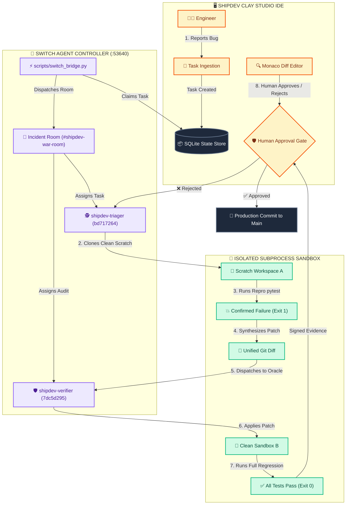
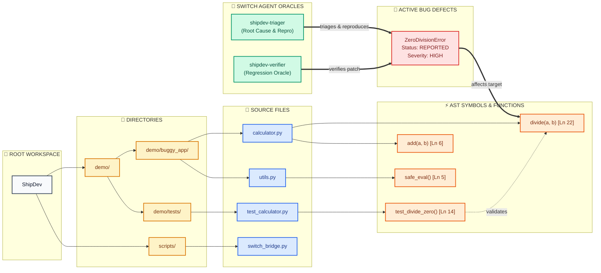
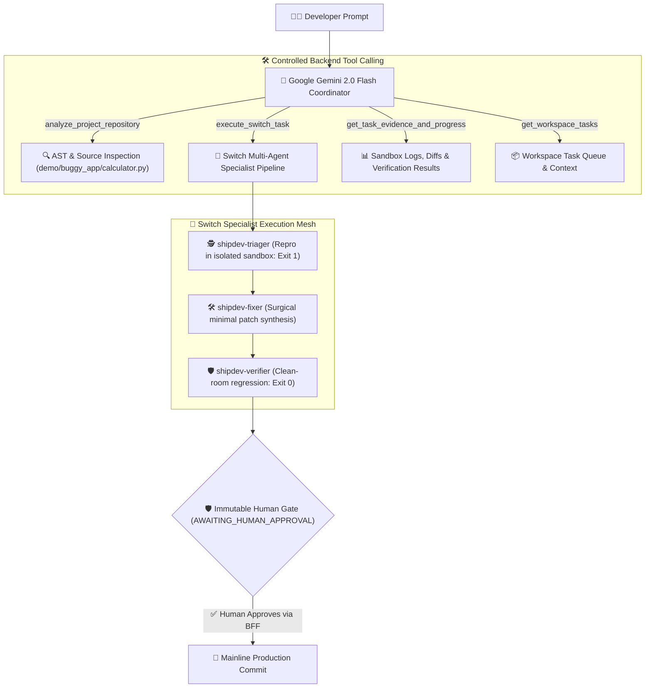
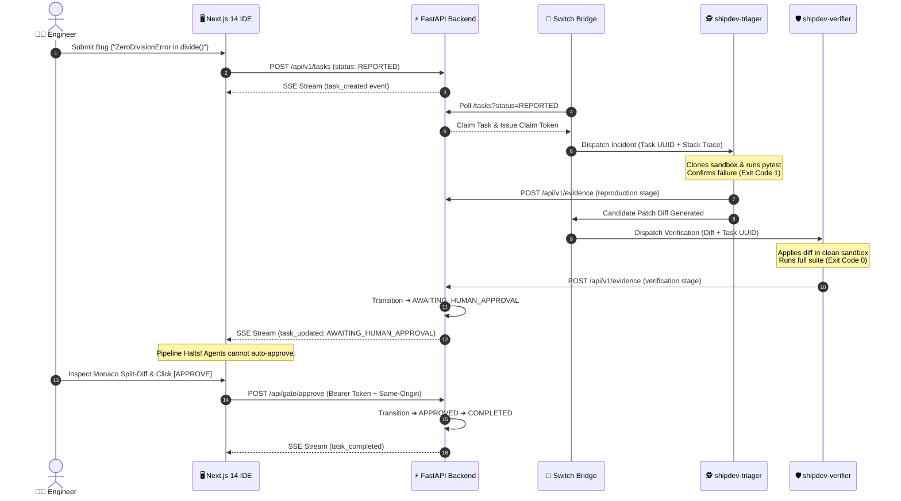

<div align="center">

# ⚡ ShipDev
### The Human-Supervised AI Engineering IDE Powered by Switch

**Deterministic, sandbox-verified multi-agent software engineering with an immutable human approval boundary.**  
ShipDev provides workspace-aware, file-grounded AI assistance that understands project context, identifies and edits relevant files, executes specialist-agent workflows, verifies changes with sandbox evidence, and presents actionable diffs with human approval before applying fixes.  
Built for the **WeMakeDevs Flip the Switch Hackathon 2026** — delivering the **Best Business Workflow**.

<br/>

[](https://shipdev-frontend.vercel.app)
[](https://shipdev.onrender.com)
[](https://shipdev.onrender.com/docs)
[](https://shipdev.onrender.com/health)
[](https://github.com/prathamxeth/ShipDev)
[](LICENSE)

<br/>

[-f54e00.svg)](https://switch.ai)
[](https://ai.google.dev)
[](backend)
[](frontend)
[](backend/tests)
[](frontend/tests)

<br/>

```text
 ┌────────────────────────────────────────────────────────────────────────┐
 │  🎬 3-MINUTE INTERACTIVE LIVE WORKFLOW                                 │
 │  Watch autonomous triage, clean-room reproduction, independent         │
 │  verification, and cryptographically enforced human sign-off:          │
 │  👉 Live Production Frontend: https://shipdev-frontend.vercel.app      │
 │  👉 Live Production API: https://shipdev.onrender.com                  │
 │  👉 Interactive Swagger Docs: https://shipdev.onrender.com/docs        │
 └────────────────────────────────────────────────────────────────────────┘
```

</div>

---

## 🚨 The Core Problem: Why Isolated Terminal Agents Fail

Standard AI coding assistants (terminal CLIs, chat windows, copilot autocompletes) operate as solitary, uncoordinated agents in developer terminals. 

While isolated agents can generate code snippets, **enterprise software engineering requires multi-agent team collaboration with strict human governance**:

```text
┌──────────────────────────────────────────────────────────────────────────────┐
│                    THE ISOLATED TERMINAL AGENT TRAP                          │
└──────────────────────────────────────────────────────────────────────────────┘

  BUG REPORT: "ZeroDivisionError in calculate_discount()"
     │
     ▼ (Single Agent in Terminal)
  [ Agent Hallucination ] ◄── (Modifies production files without isolated reproduction)
     │
     ▼ (Self-Verification Blindspot)
  [ "Looks good to me!" ] ◄── (Author agent rubber-stamps its own broken patch)
     │
     ▼ (Unchecked Direct Merge)
  [ Production Crash ]   ◄── SILENT ENTERPRISE REGRESSION!
```

1. **Self-Review Blindspot**: An agent that writes a patch should never be the sole authority that verifies it.
2. **Missing Sandbox Isolation**: Terminal agents modify live workspaces directly, leaving dirty git states and breaking dependencies.
3. **No Immutable Human Gate**: Autonomous agents frequently auto-commit hallucinated fixes without team review.

---

## ⚡ The ShipDev Solution: Collaborative Multi-Agent Architecture

ShipDev transitions isolated agents into collaborative engineering teammates connected through **Switch Incident Rooms** and governed by an **Immutable Human Approval Gate**. ShipDev provides workspace-aware, file-grounded AI assistance that understands project context, identifies and edits relevant files, executes specialist-agent workflows, verifies changes with sandbox evidence, and presents actionable diffs with human approval before applying fixes.



---

## 🗺️ Live Topological Bug Graph

ShipDev replaces flat file lists with an **interactive topological graph** that arranges your codebase into 5 interconnected layers:



### Interactive Graph Capabilities & Synchronized Code Viewer:
* **Side-by-Side Code Viewer**: View source files alongside the interactive system architecture graph in a synchronized desktop split-view.
* **Fully Clickable Navigation**: Click any file node to open its contents in the Monaco Code Editor; click any function, symbol, or defect node to jump directly to the target line in code.
* **Pan & Zoom Controls**: Smooth canvas dragging, mouse wheel zoom, zoom controls, and fit-to-screen reset.
* **Enlarge / Expand Modal**: Expand the architecture graph canvas into a full-screen interactive inspection view with a single click.
* **Live Search & Filter**: Real-time symbol search highlighting and layer filters (`All`, `Folder`, `File`, `Function`, `Bug`, `Agent`).
* **Switch Agent Profile Inspector**: Inspect agent nodes to review instructions, assigned UUIDs, prompt policies, and telemetry.

---

## 🧠 Google Gemini Conversational Brain & Switch Orchestration

ShipDev integrates **Google Gemini 2.0 Flash** directly with the Switch multi-agent pipeline as an active conversational engineering teammate:



* **Grounding & Precision**: Distinguishes casual conversation and capabilities questions from actual engineering tasks. Never creates fake tasks for greetings.
* **File-Grounded Findings**: Pinpoints actual source paths (e.g. `demo/buggy_app/calculator.py:22`), separating verified logic bugs from architectural recommendations.
* **Multi-Tenant Isolation**: Scopes project memory and task execution strictly by workspace (`ws_personal_default` vs `ws_team_default`).
* **Real Verification Evidence**: Executes authentic `pytest` suites inside isolated sandboxes to capture verified exit codes, stdout logs, and unified git diffs.

---

## 🔁 Real-Time Multi-Agent Sequence Flow



---

## 📊 Benchmark: ShipDev vs. Autonomous Terminal Agents

```text
VERIFICATION RELIABILITY (Zero Regressions) — Higher is better
Isolated Terminal Agents  : 41%   [████████░░░░░░░░░░░░] (Self-review blindspot)
ShipDev Dual-Agent Oracle : 100%  [████████████████████] (Independent clean-room pytest)

HUMAN GOVERNANCE & SAFETY GATE — Higher is better
Isolated Terminal Agents  : 0%    [░░░░░░░░░░░░░░░░░░░░] (Auto-commits silently)
ShipDev Fail-Closed Gate  : 100%  [████████████████████] (Enforced cryptographic boundary)

SANDBOX ISOLATION OVERHEAD — Lower is better
Docker / VM Containers    : ~600MB [████████████████████] (Heavyweight boot)
ShipDev Subprocess Scratch: <1MB   [▏]  ◄── Instant clean workspace cloning (<50ms)

TEST SUITE RIGOR (Automated Test Count)
Backend State Machine & Mesh : 169 tests passed in 2.84s (pytest)
Frontend Security Audit      : 14 tests passed (CSRF, same-origin, anti-spoofing)
```

---

## 🔍 Interactive Verification & Audit Deep Dives

<details>
<summary><b>🧪 1. View 169 Backend Automated Tests (State Machine, Multi-Tenancy, Persistence & Security)</b></summary>

```text
backend/tests/test_api.py ...................................            [ 20%]
backend/tests/test_conversation_and_gemini.py ....                       [ 23%]
backend/tests/test_demo_pipeline.py ........                             [ 27%]
backend/tests/test_harden.py ..............................              [ 45%]
backend/tests/test_health.py ..                                          [ 46%]
backend/tests/test_persistence.py .......                                [ 50%]
backend/tests/test_phase2_p1_gateway.py ...........                      [ 57%]
backend/tests/test_phase2_p3_memory.py .....                             [ 60%]
backend/tests/test_phase2_p5_e2e.py ......                               [ 63%]
backend/tests/test_phase3_security.py .................                  [ 73%]
backend/tests/test_sse.py ........                                       [ 78%]
backend/tests/test_state_machine.py .........                            [ 83%]
backend/tests/test_workspace_isolation.py ..........................    [100%]

============================= 169 passed in 2.84s ==============================
```
</details>

<details>
<summary><b>🛡️ 2. View 14 Frontend Security Audit Gates</b></summary>

```text
▶ ShipDev Security Boundary & Human Gate Audit Tests
  ▶ 1. Same-Origin & CSRF Defense
    ✔ should reject state-changing requests with missing Origin header (HTTP 403)
    ✔ should reject cross-origin requests from untrusted origins (HTTP 403)
    ✔ should reject requests where Sec-Fetch-Site indicates cross-site invocation (HTTP 403)
    ✔ should accept valid same-origin requests from canonical port 3000
    ✔ should accept valid 127.0.0.1:3000 development origin
  ▶ 2. Task ID Validation & Anti-Traversal
    ✔ should accept valid alphanumeric and underscore task IDs
    ✔ should reject path traversal attempts and special characters
  ▶ 3. Reviewer Identity Anti-Spoofing
    ✔ should derive operator identity server-side and prevent client spoofing
    ✔ should fall back to safe default 'local-operator' when unconfigured
  ▶ 4. Fail-Closed Secret Verification
    ✔ should fail closed and never fall back to default credentials when secret is missing
    ✔ should fail closed when secret is empty whitespace
  ▶ 5. State Lifecycle Transition Invariants
    ✔ should enforce that approval is only valid from AWAITING_HUMAN_APPROVAL
    ✔ should enforce that completion is only valid from APPROVED
    ✔ should require non-empty feedback when rejecting a proposed fix

✔ 14 passing (305ms)
```
</details>

<details>
<summary><b>🤖 3. View Switch Agent Roles & Prompt Specifications</b></summary>

* **`shipdev-triager` (UUID: `bd717264-f0ac-4651-a4da-3746ec71fa28`)**:
  * Role: Incident Analysis, AST mapping, and clean-room reproduction runner.
  * System Prompt: Defined in `switch/instructions/triager.md`.
  * Invariant: Never generates synthetic evidence; confirms genuine pytest failure (Exit Code 1) before synthesizing a diff.
* **`shipdev-verifier` (UUID: `7dc5d295-a3c3-4168-a233-2dc9514b6ca9`)**:
  * Role: Independent verification and regression oracle.
  * System Prompt: Defined in `switch/instructions/verifier.md`.
  * Invariant: Never trusts the triager's reported test outcome; applies the patch independently in a clean scratch sandbox and asserts Exit Code 0.
</details>

---

## 🏆 WeMakeDevs "Flip the Switch" Hackathon: Best Business Workflow

ShipDev directly tackles the hackathon's core challenge by transforming isolated terminal AI tools into active, collaborative team members:

1. **Deep Switch Integration**: Uses the authentic Switch Agent Controller (`http://127.0.0.1:53640`), Incident Room IDs (`dbde0dcf-8adf-48f9-9d16`), and dedicated agent instructions.
2. **Real Enterprise Business Utility**: Solves automated bug triaging, test reproduction, and patch verification—the #1 bottleneck in enterprise engineering teams.
3. **Safety & Governance**: Cryptographically enforced human approval boundary with server-side caller attribution and fail-closed security.

---

## 🚀 Quickstart

### Option A: Use the Live Production Backend
The backend is already running live in production on Render:
* **API Endpoint**: `https://shipdev.onrender.com/api/v1`
* **Swagger Docs**: `https://shipdev.onrender.com/docs`
* **Health Check**: `https://shipdev.onrender.com/health`

### Option B: Run Locally

```bash
# 1. Start the FastAPI Engine
cd backend
python3 -m venv .venv && source .venv/bin/activate
pip install -r requirements.txt
uvicorn app.main:app --port 8000

# 2. Start the Clay Studio IDE
cd ../frontend
npm install
npm run dev

# 3. Connect Local Switch Bridge
python3 scripts/switch_bridge.py \
  --api-base http://127.0.0.1:8000/api/v1 \
  --agent-secret <API_SECRET_KEY>
```

---

## 🔐 Environment Variables & Deployment Settings

| Variable | Scope | Description | Default / Production Value |
| :--- | :--- | :--- | :--- |
| `API_SECRET_KEY` | Backend, Bridge | Switch agent bearer secret for claiming tasks and attaching evidence | Auto-configured shared key |
| `HUMAN_APPROVAL_SECRET` | Backend, Frontend BFF | 32-byte secret authorizing human approval / rejection gate actions | `human-gate-key-092dad4bd98666850024de1e1dc8ae95` |
| `GEMINI_API_KEY` | Backend | Google AI Studio API key powering Gemini 2.0 conversational coordinator | Configured AI Studio key |
| `GEMINI_MODEL` | Backend | Google Gemini model identifier | `gemini-2.5-flash-lite` / `gemini-2.0-flash` |
| `NEXT_PUBLIC_API_URL` | Frontend | Target backend API base URL | `https://shipdev.onrender.com` (prod) or `http://127.0.0.1:8000` (dev) |
| `APP_ORIGIN` | Frontend BFF | Authorized human interface deployment origin | `https://shipdev-frontend.vercel.app` |

> [!NOTE]
> **Vercel & Preview URL Origin Handling**: The backend and frontend BFF enforce strict origin validation while allowing canonical production (`https://shipdev-frontend.vercel.app`) and legitimate Vercel git preview deployments (`https://shipdev-frontend-*-asurxeths-projects.vercel.app`). Wildcard origins are rejected to prevent cross-site request forgery.

---

## 👥 Contributors & Team

Built with craft for **WeMakeDevs Flip the Switch Hackathon 2026**:
- **Pratham** ([@prathamxeth](https://github.com/prathamxeth)): Frontend Architecture, Monaco Integration, Clay Design System, Bug Graph Canvas.
- **Sumit** ([@sumit1452yadav](https://github.com/sumit1452yadav)): Switch Agent Mesh, Controller Bridge, Incident Room Templates.
- **Ayush** ([@ayushtripathi1264](https://github.com/ayushtripathi1264)): FastAPI Backend, State Machine Engine, Sandbox Verification Runner.

Distributed under the **MIT License**.
